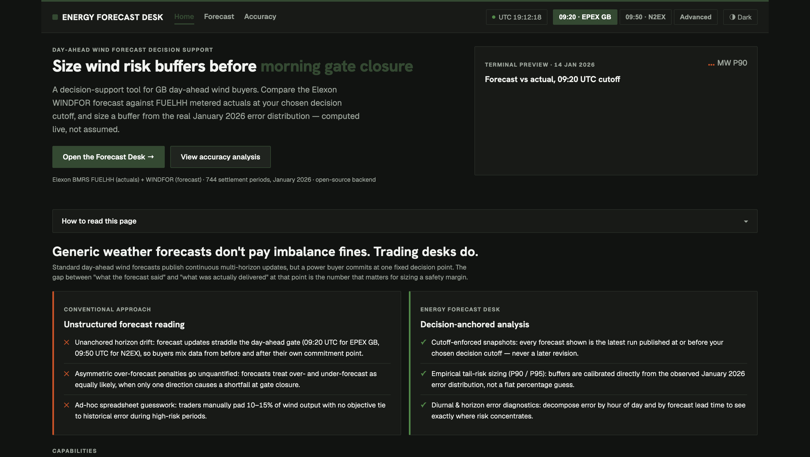

# Wind Forecast Desk

A day-ahead wind forecast decision-support tool for a UK energy utility's power buying team. It does two things: (1) shows the wind generation forecast that was actually available at the moment a buyer would have committed to a decision, and (2) quantifies how accurate that forecast turned out to be, so a buyer can size a safety buffer instead of guessing one.

Data: Elexon BMRS only (FUELHH actuals, fuelType WIND; WINDFOR forecasts), Great Britain national level. Pre-fetched into `data/*.parquet`, covering 24 Dec 2025 to 3 Feb 2026 — padded on both sides of January so no forecast or actual near the month's edges is missing.

**Live app:** <FILL: frontend URL> | **API docs:** <FILL: backend URL>/docs | **Demo video:** <FILL: unlisted YouTube URL>

CI runs lint, tests and the frontend build on every push.



## Repo structure

```
backend/
  app/
    fetch_data.py       pulls FUELHH + WINDFOR from the Elexon BMRS API into data/*.parquet
    selection.py         decision-time forecast selection and hourly alignment
    metrics.py            bias, MAE, RMSE, percentiles, by hour / day / lead time
    main.py                   FastAPI app and endpoints
    api/index.py              Vercel serverless entrypoint (re-exports the FastAPI app)
    diagnose.py, diagnose2.py, exploration.py, fetch_data2.py   exploratory scripts used while investigating the forecast bias; not part of the app
  data/                        parquet files bundled for the Vercel deployment
  tests/                       pytest suite (selection logic, metrics, API)
  Dockerfile, vercel.json, requirements.txt, ruff.toml, pytest.ini
data/                          parquet files used for local/Docker runs (same content as backend/data/)
.github/workflows/ci.yml        lint + test + build on every push/PR
docs/decisions.md               longer rationale behind the design decisions below
.env.example                    the few optional env vars, and when you'd need them
Makefile                        make install / dev / test / up
frontend/
  src/
    pages/
      Landing.jsx                overview, live backtest summary, buffer-sizing calculator
      Forecast.jsx                decision-time forecast vs. actual for one delivery day
      Accuracy.jsx                aggregate accuracy metrics across January 2026
    components/                InfoTip, HowToRead, Skeleton/RetryBanner
    api.js, useApi.js          fetch helper and a stale-while-revalidate data hook
    format.js, glossary.js, csv.js
    App.jsx, App.css           app shell, routing-by-tab, design tokens
  Dockerfile, nginx.conf, vite.config.js
docker-compose.yml              runs backend + frontend together locally
```

## Run locally

With Docker:
```
docker compose up --build   # or: make up
```
UI at http://localhost:3000, API docs at http://localhost:8000/docs.

Without Docker:
```
cd backend && pip install -r requirements.txt && uvicorn app.main:app --reload
cd frontend && npm install && npm run dev
```
Or `make install && make dev` to do both from the repo root (Ctrl+C stops both servers). The Vite dev server proxies `/api` to port 8000.

Run tests: `cd backend && pytest` or `make test`.

Refresh the underlying data (optional, hits the live Elexon API):
```
python backend/app/fetch_data.py
```

No environment variables are required for local development — see [.env.example](.env.example) for the optional ones (`VITE_API_URL`, `DATA_DIR`, `PORT`) and when you'd need them.

## How it works

1. **Fetch** — `backend/app/fetch_data.py` pulls both datasets from the Elexon BMRS API in 3-day chunks.
2. **Align** — WINDFOR forecasts are hourly; FUELHH actuals are half-hourly, so actuals are averaged to the hour (left as missing if either half-hour is missing).
3. **Select** — for each delivery hour, the forecast used is the one with the latest `publishTime <= cutoff` on D-1. This avoids look-ahead bias: no forecast published after the decision time is ever used.
4. **Metrics** — error = forecast − actual (positive means the forecast was too high, i.e. shortfall risk). Bias, MAE, RMSE, and the P05/P50/P90/P95 error percentiles, computed overall and broken down by hour of day, by day, and by forecast lead time (6-hour buckets, using every forecast run, lead time restricted to positive horizons only).

## Key assumptions

- Decision cutoff is 09:20 UK/UTC on D-1, the EPEX GB hourly day-ahead gate closure. The N2EX auction closes at 09:50. WINDFOR runs are published at :30 past the hour, so 09:20 uses the 07:30 run and 09:50 uses the 09:30 run. Both are selectable in the UI.
- Decision dates run 1–31 Jan 2026, so delivery dates run 2 Jan – 1 Feb 2026.
- All times are UTC, all generation values are MW.
- The lead-time breakdown hides buckets with fewer than 1,000 samples, since those are too small to read reliably.

## Assumptions and open questions

- **Cutoff:** 09:20 UTC is used as the EPEX GB gate closure and is the app's default. This is an assumption about the real auction time, not something verified against an official Elexon/EPEX schedule document — treat it as "best available estimate," not fact.
- **Hourly alignment:** WINDFOR is hourly and FUELHH is half-hourly, so actuals are averaged to the hour. An open question is whether this averaging itself introduces any small bias versus comparing WINDFOR to a true hourly-metered series, if one existed.
- **"Decision made in January" means decision date 1–31 Jan 2026**, i.e. delivery dates 2 Jan – 1 Feb 2026. It does not mean "forecasts published in January" — some underlying forecast runs used were published in late December.
- **The bias is unexplained.** The forecast runs persistently and substantially above metered actuals (+15.5% on average), and this is reported as an observed fact, not a diagnosed one. Curtailment and a scope mismatch between WINDFOR (which may include embedded generation) and FUELHH (metered only) are both plausible, untested explanations. No bias correction is applied anywhere in the app.

## Key findings (January 2026, 09:20 UTC cutoff, n = 744 hourly slots)

- Bias: +1,748 MW (+15.5% of mean actual wind). MAE: 2,039 MW (18.1%). RMSE: 2,505 MW.
- The error is asymmetric: P95 over-forecast is +5,283 MW and P90 is +4,098 MW, while P05 is only −1,151 MW. The expensive misses are concentrated in the direction where actual wind came in well below forecast.
- Bias is positive in every hour of the day (largest overnight, around 2.3 GW at 02:00–06:00 UTC) and on 87% of days. It also grows with the forecast level — roughly +0.4 GW in the lowest-wind quintile versus roughly +3.5 GW in the highest. Even the near-real-time forecast (latest run before the delivery hour) carries about +1.5 GW of bias, so most of the effect is not simply a lead-time/decay artifact.
- Error spread (P95, RMSE) increases with forecast lead time, as expected.
- The result is not very sensitive to the exact cutoff: moving it from 09:20 to 09:50 changes MAE by about 1% (2,039 → 2,013 MW).
- The cause of the persistent over-forecast is not confirmed. Plausible explanations — for example curtailment, or a scope difference between what WINDFOR forecasts and what FUELHH meters — were not tested against additional data. The bias is reported as observed and is not silently corrected anywhere in the app.

## API endpoints

All routes are versioned under `/api/v1`. Every response (success and error) has a Pydantic model, so `/docs` shows real schemas, not generic JSON blobs. Errors always come back as `{"error": {"code": "...", "message": "..."}}` — whether raised manually (e.g. a bad cutoff) or by FastAPI's own request validation (e.g. a query param out of range) — through one shared error-response helper in `main.py`.

| Endpoint | Query params | Returns |
|---|---|---|
| `/api/v1/health` | — | liveness check |
| `/api/v1/meta` | — | data version and real coverage (decision dates, actuals range, forecast publish/target range) and default cutoff — the frontend reads this instead of hard-coding any date |
| `/api/v1/forecast` | `decision_date`, `cutoff` | hourly forecast/actual/error for one delivery day |
| `/api/v1/metrics/summary` | `cutoff` | bias, MAE, RMSE, percentiles over the full sample |
| `/api/v1/metrics/by-hour` | `cutoff` | the above, broken down by hour of day |
| `/api/v1/metrics/by-day` | `cutoff` | the above, broken down by decision date |
| `/api/v1/metrics/by-horizon` | — | accuracy vs. forecast lead time (6h buckets) |
| `/api/v1/metrics/histogram` | `cutoff`, `bins` | error distribution histogram |

## Design decisions and trade-offs

See [docs/decisions.md](docs/decisions.md) for the longer rationale behind the choices below.

- Data is pre-fetched into parquet and cached in memory at startup rather than queried from Elexon per request — this keeps the API reliable and fast on a serverless deployment, at the cost of needing a manual refresh to pick up new data.
- Selection and metrics logic are pure functions, independent of the API layer, so they're directly unit-testable without spinning up a server.
- The decision cutoff is a parameter throughout, not a hardcoded constant, so the sensitivity check (09:20 vs. 09:50) required no code changes.
- The "cautious plan" line shown on the forecast chart subtracts the full-January P90 from the forecast. It illustrates the size of a sensible buffer; it is not a back-tested trading rule and should not be read as one.

## Testing

The test suite covers:
- Selection edge cases: a forecast published after the cutoff is excluded; one published exactly at the cutoff is included; when multiple eligible forecasts exist, the most recently published one wins; a slot with no eligible forecast is simply absent, not silently filled.
- A look-ahead regression guard: a forecast published after the cutoff must never appear in the selected dataset.
- Data quality: duplicate `(startTime, publishTime)` forecast rows are deduplicated; an hour with only one of its two half-hourly actuals present comes out as missing (NaN), not a partial average.
- Metrics: bias, MAE and RMSE on a small hand-computed DataFrame are checked against numbers worked out by hand, and a row with a missing actual is confirmed to be excluded from the metrics rather than silently zero-filled.
- `validate_full_coverage()`, a startup check that raises loudly if January isn't fully covered (wrong row count, or any missing forecast/actual) — this runs automatically whenever the API process starts, not just in tests.
- API behavior: the forecast endpoint returns the expected row count for a full day, and invalid inputs (out-of-range dates, malformed cutoffs) are rejected with a validation error.
- The error response shape is consistent whether the error comes from a manual check or from FastAPI's own request validation.
- `/api/v1/meta` reflects the real loaded data rather than a hardcoded range, and every `response_model`-backed endpoint actually matches its declared schema — this test suite caught a real bug during development: `by-day`'s date column needed an explicit fix to pass its own response model.

## Possible next steps

- A bias-corrected forecast view that only uses a trailing window of past errors available at decision time, to avoid look-ahead leakage.
- Incorporate demand data to compute net purchase need rather than wind output in isolation.
- Investigate the cause of the persistent bias using additional datasets (e.g. embedded generation estimates, curtailment instructions).

## AI usage

This project was built with AI assistance (Claude) for planning, code generation, debugging, and review. I reviewed and tested the code myself, and the analysis choices and assumptions described above are my own responsibility.
